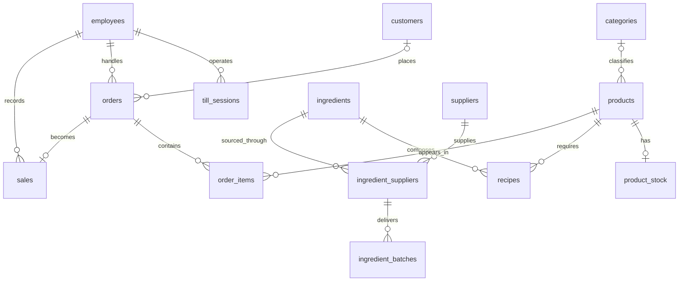

# Bakery Database

An operational relational database for a fictional neighborhood bakery, designed to connect sales, recipes, inventory, suppliers, customers, and till operations.

This project is a database design case study. It demonstrates how business rules can be translated into normalized tables, foreign keys, constraints, indexes, and derived views while preserving trustworthy transaction history.

> All people, companies, tax identifiers, and contact details in the sample data are fictional and intended only for demonstration.

## Business problem

A bakery needs more than a list of products and sales. It must know what was sold and at which price, which ingredients are available, where each batch came from, what will expire next, and when stock should be replenished.

The model supports four operational areas:

- **Sales:** orders, line items, payments, customers, and responsible employees.
- **Production:** products, recipes, and ingredient consumption requirements.
- **Inventory:** finished-product stock and ingredient batches with expiration dates.
- **Operations:** suppliers, employee records, and till opening and closing sessions.

## Questions the database can answer

- How much revenue did each order generate?
- Which products and categories sell the most?
- What price was charged at the time of each sale?
- Which ingredients are below their minimum stock level?
- Which available ingredient batch expires next?
- Which suppliers can provide a given ingredient?
- Which employee handled an order, sale, or till session?

## Data model



The model contains 14 base tables and two derived views:

- `order_totals` calculates order value from its line items.
- `ingredient_stock` aggregates available batches and exposes the next expiration date.

## Design decisions

### Preserve historical prices

`products.sale_price_cents` stores the current catalog price, while `order_items.unit_price_cents` records the price actually charged. Changing a product's price therefore does not rewrite sales history.

The sample data demonstrates this intentionally: Chicken Coxinha has a catalog price of 750 cents and appears in an earlier transaction at 500 cents.

### Store currency as integer cents

Monetary values use integer cents in the operational model. This avoids binary floating-point rounding errors and makes validation straightforward.

### Track ingredients by batch

Ingredient inventory is not stored as one mutable total. `ingredient_batches` records the supplier, received quantity, remaining quantity, receipt timestamp, and expiration date for each delivery. The `ingredient_stock` view provides the aggregate needed by day-to-day operations.

### Model supplier choice explicitly

An ingredient may be offered by multiple suppliers, and a supplier may provide multiple ingredients. The `ingredient_suppliers` bridge models this many-to-many relationship and ensures every received batch refers to an approved pairing.

### Enforce rules in the database

Constraints reject invalid states such as negative prices, nonpositive order quantities, unknown order statuses, remaining batch quantities above their received quantities, and till sessions closed without a final balance.

## Technology choices

**SQLite is the canonical operational database.** It is portable, transactional, easy to reproduce, and well suited to demonstrating application-oriented relational design.

**DuckDB is maintained as a secondary dialect** for analytical experimentation. Its schema follows the same entities and naming, with documented accommodations for unsupported partial indexes and foreign-key delete actions.

## Quick start

Requirements:

- Python 3.13+
- [uv](https://docs.astral.sh/uv/)

Install the locked dependencies:

```bash
uv sync
```

Create and seed the SQLite database:

```bash
uv run python -c "from pathlib import Path; import sqlite3; connection = sqlite3.connect('bakery.db'); connection.execute('PRAGMA foreign_keys = ON'); connection.executescript(Path('sql/create_tables.sql').read_text()); connection.executescript(Path('sql/insert_sample.sql').read_text()); connection.close()"
```

Inspect the generated database with SQLite, a VS Code database extension, or any compatible client. The exploratory notebook is available at [`analysis.ipynb`](analysis.ipynb).

## Example analysis

Calculate completed-order revenue while preserving the original transaction price:

```sql
SELECT
orders.order_id,
orders.order_timestamp,
customers.customer_name,
order_totals.total_amount_cents / 100.0 AS total_amount
FROM orders
JOIN order_totals ON order_totals.order_id = orders.order_id
LEFT JOIN customers ON customers.customer_id = orders.customer_id
WHERE orders.order_status = 'Completed'
ORDER BY orders.order_timestamp;
```

Review ingredient availability and upcoming expiration dates:

```sql
SELECT
ingredients.ingredient_name,
ingredient_stock.current_quantity,
ingredient_stock.minimum_quantity,
ingredient_stock.next_expiration_date,
ingredient_stock.current_quantity < ingredient_stock.minimum_quantity AS needs_restock
FROM ingredient_stock
JOIN ingredients ON ingredients.ingredient_id = ingredient_stock.ingredient_id
ORDER BY needs_restock DESC, ingredient_stock.next_expiration_date;
```

## Repository structure

```text
.
|-- analysis.ipynb                # Exploratory Python and SQL notebook
|-- sql/
|   |-- create_tables.sql         # Canonical SQLite schema
|   |-- create_tables_duckdb.sql  # Equivalent DuckDB schema
|   `-- insert_sample.sql         # Shared fictional sample data
|-- pyproject.toml                # Python project metadata
|-- uv.lock                       # Reproducible dependency lock
`-- LICENSE                       # MIT license
```

## Current scope and roadmap

The current release focuses on schema design, integrity rules, and a compact scenario that exercises the principal relationships. Planned portfolio extensions include:

- Deterministic synthetic sales and inventory history covering several months.
- Business analysis for product mix, peak periods, replenishment, and expiration risk.
- Automated schema and constraint tests for both database dialects.
- Documented requirements, business rules, and architectural decisions.
- A read-only browser deployment for exploring the sample database.

Cost accounting, production runs, purchases, and waste are intentionally outside the current model. They would be required before drawing conclusions about product margin or operational loss.

## License

Released under the [MIT License](LICENSE).
